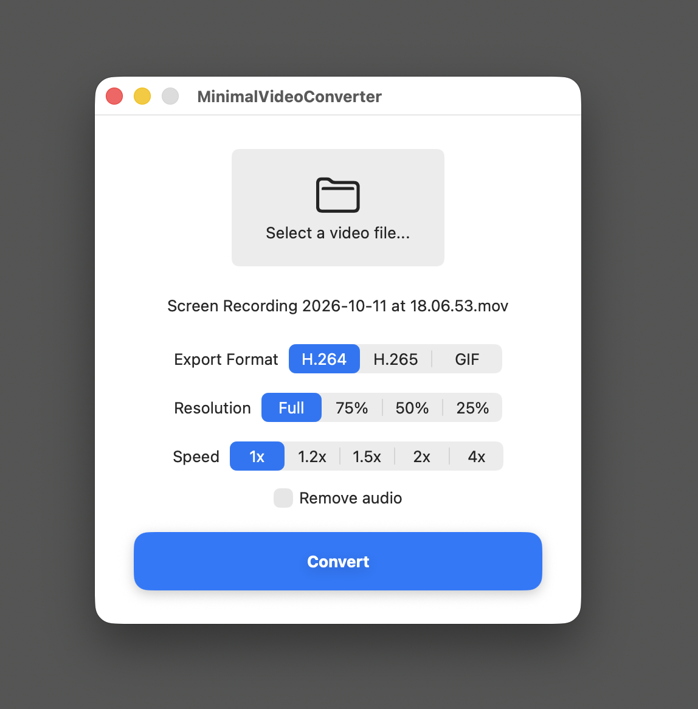

# MinimalVideoConverter

A minimal macOS app for converting and compressing videos using FFmpeg.



## Features

- **Formats** — export as H.264, H.265, or GIF
- **Resolution** — downscale to 75%, 50%, or 25% of the original
- **Speed** — change playback speed (1×, 1.2×, 1.5×, 2×, 4×)
- **Remove audio** — strip the audio track from the output
- **Drag and drop** — drop a video file directly onto the window

Output is saved alongside the source file as `<name> (reduced).<ext>`.

## Requirements

- macOS Ventura or later

## Install

```bash
brew tap dimw/minimal-video-converter
brew install --cask minimal-video-converter
```

FFmpeg is installed automatically as a dependency.

Or download the latest `.app` from [Releases](https://github.com/dimw/minimal-video-converter/releases) — FFmpeg must be installed separately in that case (`brew install ffmpeg`).

## Build from source

```bash
xcodebuild -scheme MinimalVideoConverter -configuration Release -derivedDataPath build
```

The app will be at `build/Build/Products/Release/MinimalVideoConverter.app`.
